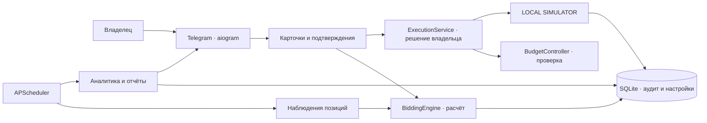

<div align="center">

<h1>Avito Bid Manager</h1>

<p><strong>Локальное управление ставками и бюджетами Авито из Telegram</strong></p>

<p><code>Python 3.12+</code> · <code>aiogram 3</code> · <code>SQLite</code> · <code>APScheduler</code> · <code>Docker</code></p>

<p><a href="#быстрый-старт">Быстрый старт</a> · <a href="#telegram">Telegram</a> · <a href="#режимы-работы">Режимы</a> · <a href="#документация">Документация</a></p>

</div>

> **Текущий статус.** Приложение запускается в `DRY_RUN`. Подтверждённые изменения ставок исполняются в локальном симуляторе. Реальные платные операции и `AUTO` заблокированы. Чтение данных Авито требует настроенного доступа и проверенных контрактов API.

## Возможности

| Раздел | Что доступно |
| --- | --- |
| 📢 **Объявления** | До пяти объявлений, отдельные карточки, поиск по ID, запросы и регионы, локальная пауза, исключение и восстановление. |
| 🎯 **Ставки** | Подтверждённая и рекомендованная ставки, целевые позиции, диапазоны, шаги и cooldown. Ручная ставка и предложения ASSISTED проходят предпросмотр и подтверждение. |
| 💰 **Бюджеты** | Дневные лимиты аккаунта и объявлений, резерв, остаток и причины блокировки. Уведомления на порогах 80% и 95%. |
| 📊 **Аналитика** | Сегодня, 7 и 14 закрытых дней, карточка объявления или сравнение всех. Расходы, просмотры, обращения, CPL, CPV, конверсия, позиции и изменения ставок. Рекомендации PerformanceOptimizer. |
| ⏰ **Расписание** | Рабочие часы алгоритма, интервалы наблюдения, время ежедневного отчёта и пауза мониторинга. Последний и следующий запуски, ошибки задач. |
| 🛡 **Диагностика** | Проверка подключения, свежесть данных, состояние SQLite и планировщика, журнал изменений и уведомления о сбоях. |

## Быстрый старт

Нужны **Python 3.12+** и терминал, открытый в корне проекта. Для демонстрации ключи Авито и Telegram не требуются.

### Windows · PowerShell

```powershell
py -3.12 -m venv .venv
$env:PYTHONUTF8 = '1'
.\.venv\Scripts\python -m pip install -e '.[dev]'
if (-not (Test-Path -LiteralPath .env)) { Copy-Item .env.example .env }
New-Item -ItemType Directory -Force data | Out-Null
.\.venv\Scripts\alembic upgrade head
.\.venv\Scripts\python -m app.main demo
```

### Linux · Raspberry Pi

```sh
python3.12 -m venv .venv
. .venv/bin/activate
python -m pip install -e '.[dev]'
test -f .env || cp .env.example .env
mkdir -p data
alembic upgrade head
python -m app.main demo
```

Демонстрация использует SQLite в памяти. В результате ожидаются `simulated: true`, `status: DRY_RUN` и `provider_writes: 0`. Рабочая БД по умолчанию находится в `data/manager.db`.

Чтобы запустить постоянный сервис, выполните `python -m app.main serve`. В PowerShell используйте `.\.venv\Scripts\python -m app.main serve`.

## Telegram

Добавьте настройки в локальный `.env`. Если токен уже задан, достаточно указать числовой ID владельца.

```dotenv
TELEGRAM_BOT_TOKEN=<токен_бота>
TELEGRAM_ADMIN_IDS=[123456789]
TIMEZONE=Europe/Moscow
MODE=DRY_RUN
```

1. Запустите сервис и отправьте **`/start`** в личном чате с ботом.
2. Откройте **Мои объявления → Добавить объявление**, введите ID и пройдите мастер. При доступном чтении API бот проверит принадлежность объявления аккаунту. Запись без подтверждения получит метку `UNVERIFIED`.
3. Откройте карточку, задайте запросы, целевые позиции, диапазон ставки и дневной лимит. Для ручной симуляции включите LOCAL SIMULATOR в настройках объявления, задайте стартовую ставку и выберите ASSISTED.
4. Настройте интервал наблюдения и время ежедневного отчёта в разделе **Расписание**.

| Команда | Что открывает |
| --- | --- |
| `/start`, `/help`, `/items` | Главное меню и карточки объявлений |
| `/analytics [today\|7\|14] [ID]`, `/compare [today\|7\|14]` | Аналитику по периоду и сравнение объявлений |
| `/budget [ID]`, `/positions ID`, `/history ID` | Бюджет, наблюдения позиций и историю изменений |
| `/status`, `/cancel` | Диагностику и отмену текущего ввода |

Кнопки и сообщения обрабатываются только в личных чатах указанных администраторов. Настройки и предложения сохраняются в SQLite. После перезапуска откройте меню заново через `/start`. [Полное руководство по Telegram](docs/TELEGRAM_CONTROL.md).

## Режимы работы

| Режим | Поведение |
| --- | --- |
| 🟡 **DRY_RUN** | Рассчитывает изменения и записывает решения в журнал. Ставки остаются прежними. |
| 🧪 **ASSISTED** | Позволяет подтвердить или отклонить предложение. Запись проходит через ExecutionService в LOCAL SIMULATOR. Для ручной ставки нужен свежий финансовый срез, пригодный для симуляции. |
| 🔒 **AUTO** | Заблокирован. Причины доступны в Telegram и в отчёте `readiness`. |

**Локальные лимиты и пауза относятся к работе менеджера.** Активное продвижение и списания на стороне Авито управляются в кабинете Авито. Позиции, расходы и ставка показываются с источником и временем данных, когда они доступны. Подтверждённые данные, предварительные показатели и результаты симуляции имеют разные метки.

## Конфигурация

Шаблон настроек находится в [`.env.example`](.env.example). Секреты хранятся в локальном `.env`, который исключён из Git.

| Переменная | Назначение | Пример или значение по умолчанию |
| --- | --- | --- |
| `DATABASE_URL` | Путь к локальной базе | `sqlite+aiosqlite:///data/manager.db` |
| `TIMEZONE` | Рабочие часы, отчёты, границы бюджетного дня | `Europe/Moscow` |
| `ACCOUNT_DAILY_LIMIT_KOPECKS` | Начальный дневной лимит аккаунта | `100000` коп. (1 000 ₽) |
| `BUDGET_RESERVE_PERCENT` | Резерв для локального контроля расходов | `20` |
| `MAX_SPENDING_DATA_AGE_MINUTES` | Допустимый возраст финансового среза | `30` |
| `TELEGRAM_CONFIRMATION_MINUTES` | Срок подтверждения предложения | `5` |
| `STATISTICS_READ_ENABLED` | Плановый сбор статистики Авито в режиме чтения | `false` |
| `BACKUP_RETENTION` | Количество ежедневных копий SQLite | `7` |

Суммы в конфигурации, CLI и формах редактирования Telegram задаются целыми копейками. Подтверждённый общий лимит из Telegram хранится в SQLite и загружается при запуске.

## CLI и проверка интеграции

Команды ниже выполняются из корня проекта с активированным виртуальным окружением.

| Команда | Назначение |
| --- | --- |
| `python -m app.main health` | Проверяет локальную БД и heartbeat запущенного сервиса |
| `python -m app.cli readiness` | Показывает уровни готовности и причины блокировок |
| `python -m app.cli readiness --check-avito` | Дополняет отчёт проверками чтения Авито |
| `python -m app.cli check-avito` | Диагностирует доступ к аккаунту, объявлениям и доступным данным |
| `python -m app.main add-item --file examples/item.json` | Загружает конфигурацию объявления |
| `python -m app.main import-positions --file PATH` | Импортирует наблюдения поисковых позиций |
| `python -m app.main import-statistics --file PATH` | Импортирует финансовые срезы и метрики |
| `python -m app.main backtest --file examples/phase4_backtest.json` | Воспроизводит решения на историческом наборе |
| `python -m app.main backup --file data/backups/manual.db` | Создаёт ручную копию SQLite |

Для команд изменения рабочей БД остановите сервис, чтобы освободить локальную блокировку. Подключение Авито начинается с credentials, проверки ожидаемого ID аккаунта и сопоставления официальных OpenAPI-экспортов. Источник оперативных позиций подключается отдельно. [Совместимость API](docs/AVITO_API_COMPATIBILITY.md) · [Проверка реального аккаунта](docs/REAL_ACCOUNT_CHECKLIST.md).

## Архитектура



- `app/telegram/` — меню, FSM, подтверждения и доставка событий.
- `app/bidding/` и `app/services/` — стратегия, бюджетные ограничения, исполнение, аналитика и проверка готовности.
- `app/avito/` и `app/positions/` — адаптеры, локальный симулятор и источники наблюдений.
- `app/database/` и `migrations/` — асинхронная SQLite, журнал и миграции Alembic.

## Docker и эксплуатация

Подготовьте локальный `.env` перед запуском, если нужен Telegram или чтение данных Авито.

```sh
docker compose up -d --build
docker compose logs -f --tail=100 manager
docker compose exec manager python -m app.main health
```

Контейнер применяет миграции при запуске, хранит SQLite в томе `manager-data` и работает от непривилегированного пользователя. Запускайте один экземпляр `manager` на рабочую БД и токен бота. Healthcheck проверяет локальный процесс и БД.

Сервис создаёт резервную копию SQLite ежедневно в **03:00** по `TIMEZONE`. Для обновления остановите сервис, создайте копию, обновите код и зависимости, примените миграции и проверьте готовность. При незавершённой операции после рестарта менеджер фиксирует `UNKNOWN` и `FAIL_SAFE` до сверки. [Развёртывание и обновление](docs/DEPLOYMENT.md) · [Восстановление](docs/INCIDENT_RECOVERY.md).

## Тесты

Проверки запускаются локально без ключей и сетевых обращений к Авито.

```sh
python -m pytest -q
ruff check .
ruff format --check .
```

## Документация

| Что нужно сделать | Где читать |
| --- | --- |
| Настроить бота и управлять объявлениями | [Telegram-панель](docs/TELEGRAM_CONTROL.md) |
| Подключить позиции или импортировать наблюдения | [Источники позиций](docs/POSITION_PROVIDERS.md) |
| Разобрать алгоритм ставок и провести backtest | [Стратегия и backtesting](docs/PHASE_4.md) |
| Проверить финансовые данные и форматы импорта | [Бюджеты и аналитика](docs/PHASE_5.md) |
| Проверить доступ к Авито и статус интеграции | [Совместимость API](docs/AVITO_API_COMPATIBILITY.md) · [Чек-лист аккаунта](docs/REAL_ACCOUNT_CHECKLIST.md) · [Отчёт о готовности](docs/READINESS_REPORT.md) |
| Развернуть, обновить или восстановить сервис | [Развёртывание](docs/DEPLOYMENT.md) · [Восстановление после сбоя](docs/INCIDENT_RECOVERY.md) |
| Посмотреть историю разработки | [Отчёт по фазам](docs/PHASE_REPORT.md) |
